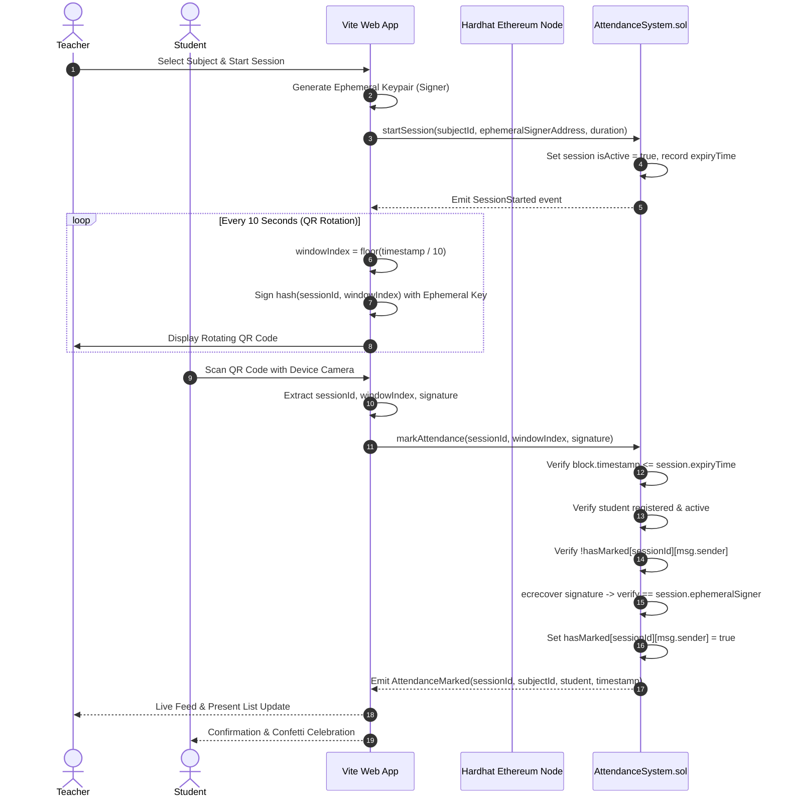

# Blockchain-Based Academic Attendance System

A decentralized, tamper-proof academic attendance tracking protocol built on Ethereum and Solidity. The system eliminates proxy attendance, unauthorized record tampering, and administrative discrepancies by leveraging time-bounded sessions, rotating cryptographically signed QR codes verified on-chain via ECDSA (`ecrecover`), and strict role-based access control.

---

## Table of Contents

- [Why Blockchain?](#why-blockchain)
- [Key Features](#key-features)
- [Screenshots](#screenshots)
- [System Architecture](#system-architecture)
- [Tech Stack](#tech-stack)
- [Prerequisites](#prerequisites)
- [Quick Start](#quick-start)
- [Role Walkthrough](#role-walkthrough)
- [MetaMask Network Configuration](#metamask-network-configuration)
- [Demo Mode](#demo-mode)
- [Project Structure](#project-structure)
- [Known Limitations](#known-limitations)
- [Future Scope](#future-scope)
- [Author & License](#author--license)

---

## Why Blockchain?

Conventional attendance systems rely on physical sign-in sheets, RFID cards, or centralized database servers. These legacy approaches suffer from critical vulnerabilities:
- **Proxy Attendance**: Students easily sign on behalf of absent peers or swap RFID tags.
- **Tampering & Manipulation**: Centralized databases allow unauthorized edits, retroactive attendance modifications, and insider manipulation with zero auditable trace.
- **Lack of Independent Verification**: External entities (such as accreditation boards, scholarship committees, and prospective employers) have no mechanism to verify the authenticity of an academic record without relying on opaque institutional intermediaries.

**Our Solution**:
1. **Immutable & Tamper-Proof**: Once an attendance transaction is mined into a block, the record cannot be altered, deleted, or backdated.
2. **Publicly & Cryptographically Verifiable**: Every attendance record stores the session identifier, subject ID, student wallet address, and on-chain timestamp, verifiable by anyone using standard Ethereum JSON-RPC calls.

---

## Key Features

- **Role-Based Access Control (RBAC)**: Enforced directly at the Solidity smart contract layer across four tiers: `Admin`, `Teacher`, `Student`, and public observers.
- **Timed Attendance Sessions**: Teachers initiate sessions with configurable durations (e.g., 5 to 10 minutes, max 300 seconds); the smart contract automatically rejects any check-ins once the block timestamp exceeds the session expiry time.
- **Rotating Signed QR Codes**: Teachers broadcast dynamic QR codes powered by ephemeral keypairs. Every 10 seconds, the frontend generates a new rotation window signed by the ephemeral signer.
- **On-Chain ECDSA Verification (`ecrecover`)**: When a student scans the QR code, the contract reconstructs the message digest `keccak256(sessionId, windowIndex)` and recovers the signer's address using `ecrecover`, validating that it matches the session's registered ephemeral signer.
- **Strict Duplicate Prevention**: The contract maintains a mapping `hasMarked[sessionId][studentAddress]`, reverting duplicate attempts with `"Already marked attendance"`.
- **Live Event Feed**: Real-time event subscription (`AttendanceMarked`, `SessionStarted`, `SessionEnded`, `StudentRegistered`) updates the UI instantly as blocks are confirmed.
- **Defaulter List & Attendance Analytics**: Real-time calculation of student attendance percentages per subject and overall, automatically flagging students falling below the mandatory 75% threshold.
- **Public Verification Portal**: Allows anyone to enter a student enrollment number or wallet address to inspect complete attendance statistics and transaction hashes.
- **CSV Export**: Export filtered attendance records and session rosters directly to CSV for administrative archiving.

---

## Screenshots

> *Note: Place your screenshot images in `docs/screenshots/` with the filenames indicated below.*

### 1. Admin Portal
*Manage academic departments, faculty registration, student rosters, and subject assignments.*


### 2. Teacher Live QR Session
*Dynamic rotating QR code with real-time countdown, live present student roster, and ephemeral signature verification.*


### 3. Student Attendance History
*Personal attendance metrics, subject-by-subject percentage breakdown, defaulter warnings, and verified on-chain history.*


---

## System Architecture



---

## Tech Stack

- **Smart Contracts**: Solidity `0.8.24`, OpenZeppelin patterns
- **Blockchain Development**: Hardhat, Hardhat Toolbox, Ethers.js v6
- **Frontend Framework**: React 18, Vite
- **Styling**: Tailwind CSS, Glassmorphic UI design tokens
- **Icons & Visualization**: Lucide React, Recharts
- **QR Code Scanning & Generation**: `html5-qrcode`, `qrcode.react`
- **Testing**: Mocha, Chai, Hardhat Network

---

## Prerequisites

- **Node.js**: Version 18.0.0 or higher (`node -v`)
- **npm**: Version 9.0.0 or higher (`npm -v`)
- **MetaMask**: (Optional) Browser extension for custom wallet interactions. *Not required for testing — the application includes a built-in instant Demo Account Switcher.*

---

## Quick Start

### 1. Clone & Install Dependencies

```bash
git clone https://github.com/your-username/blockchain-attendance-system.git
cd blockchain-attendance-system
npm install
```

### 2. Run All Automated Tests

Execute the 33 comprehensive smart contract unit and integration tests:

```bash
npx hardhat test
```

### 3. Launch Demo Mode (One-Click Runner)

The `demo` script automatically handles everything:
1. Cleans any stale processes on port `8545`.
2. Compiles smart contracts with Hardhat.
3. Launches a local Hardhat Ethereum node.
4. Deploys the `AttendanceSystem` smart contract.
5. Registers faculty, student roster, subjects, and generates 36 past sessions with attendance history.
6. Boots the Vite development frontend server at `http://localhost:5173`.

```bash
npm run demo
```

Open your browser at **`http://localhost:5173`**.

---

## Role Walkthrough

Use the **Demo Switcher** dropdown in the top-right corner of the navigation bar to switch between test roles instantly:

### 🏛️ Admin (`Account #0` — `0xf39F...2266`)
- Access **Admin Portal**.
- Register new faculty members with names and department affiliations.
- Register new students with academic enrollment IDs.
- Create new subjects and assign them to registered faculty.
- Toggle emergency demo fallback if needed.

### 👨‍🏫 Teacher (`Accounts #1 – #4`)
- Access **Teacher Live Hub**.
- View subjects assigned to your account.
- Launch a live session: sets an active duration and starts the rotating QR code generator.
- Watch students appear in real time on the **Live Present List** as their transactions are mined.
- Conclude the session manually or allow it to expire automatically.

### 🎓 Student (`Accounts #5 – #14`)
- Access **Student Portal**.
- View overall attendance percentage, total sessions conducted, and attendance status per subject.
- Defaulter warnings automatically appear if attendance is below 75% (e.g. Accounts #8, #10, #12).
- Click **Join Active Session** to open the camera scanner and scan the teacher's live QR code.
- View verified attendance timeline with cryptographic transaction hashes.

### 🔍 Public Verification (`Any User`)
- Access **On-Chain Verification**.
- Search by Student Enrollment Number (e.g. `ENR-2024-001`) or Ethereum wallet address.
- View independent, verifiable attendance statistics and complete session logs directly from the blockchain.

---

## MetaMask Network Configuration

If you prefer to connect with your own MetaMask wallet instead of the built-in account switcher:

| Setting | Value |
| --- | --- |
| **Network Name** | Hardhat Local |
| **New RPC URL** | `http://127.0.0.1:8545` |
| **Chain ID** | `31337` |
| **Currency Symbol** | `ETH` |

To import test accounts into MetaMask, copy any private key displayed in the terminal when running `npx hardhat node`.

---

## Demo Mode

The application includes an integrated **Demo Switcher** designed for friction-free presentations, evaluations, and testing:
- **No MetaMask extension required**: Switch directly between the Admin, 4 Teachers, and 10 Students with a single click.
- **Roster & Defaulter Demonstration**: Pre-populated with realistic academic data:
  - High attendees (>85%)
  - Moderate attendees (75%–85%)
  - Defaulters (<75%) to showcase automated academic alerts.
- **Privacy First**: Student and faculty names are anonymized by default (`ANONYMIZE_NAMES = true` in `roster.config.js`).

---

## Project Structure

```text
├── contracts/
│   └── AttendanceSystem.sol       # Solidity smart contract (RBAC, Sessions, ecrecover)
├── scripts/
│   ├── demo.cjs                   # Master all-in-one demo launcher
│   ├── deploy.js                  # Deployment script saving ABI & address
│   ├── register-class.js          # Roster registration & past session seeder
│   └── reset.cjs                  # Port cleanup and cache reset utility
├── src/
│   ├── components/
│   │   ├── admin/                 # Admin management tabs & registration forms
│   │   ├── common/                # Navbar, Demo Switcher, Live Event Feed
│   │   ├── student/               # QR scanner modal, attendance history table
│   │   └── teacher/               # Rotating QR generator, live attendance monitor
│   ├── context/
│   │   └── Web3Context.jsx        # Ethers.js provider, signer, and state management
│   ├── pages/
│   │   ├── AdminDashboard.jsx     # Admin management portal
│   │   ├── LandingPage.jsx        # Protocol overview and features
│   │   ├── StudentDashboard.jsx   # Student statistics & attendance history
│   │   ├── TeacherDashboard.jsx   # Teacher session control center
│   │   └── VerificationPage.jsx   # Public on-chain verification portal
│   └── utils/
│       ├── contractConfig.js      # Auto-generated contract ABI and address (gitignored)
│       └── helpers.js             # Formatting, date parsing, address shortening
├── test/
│   └── AttendanceSystem.test.cjs  # 33 comprehensive automated tests
├── docs/
│   └── screenshots/               # Application UI screenshots placeholder
├── roster.config.js               # Centralized faculty, student, & subject configuration
├── hardhat.config.cjs             # Hardhat network and compiler configuration
└── package.json                   # Project scripts and dependencies
```

---

## Known Limitations

1. **QR Relay & Live-Sharing**: A student physically present in the classroom could theoretically photograph or stream their screen to an absent friend within the active 10-second rotation window.
2. **Local Test Chain**: Out of the box, the project is configured for local Hardhat node execution (`http://127.0.0.1:8545`). Deployment to public testnets (e.g., Sepolia) requires setting environment variables for RPC endpoints and funding deployer accounts with testnet ETH.
3. **Demo OTP Fallback**: For environments without camera or webcam hardware permissions, a 6-digit demo code fallback is available. In production, this fallback can be permanently disabled on-chain by the Admin using the contract's `demoFallbackEnabled` toggle.
4. **Simulated Attendance Data**: Historical data seeded during demo initialization uses simulated timestamps and session counters for demonstration purposes.

---

## Future Scope

- **BLE Proximity & Geofencing**: Integrate Bluetooth Low Energy (BLE) beacons or GPS geofencing with the rotating QR challenge to ensure physical presence inside the lecture hall.
- **Soulbound Tokens & Decentralized Identifiers (DIDs)**: Issue non-transferable student identity credentials (SBTs) so student wallets cannot be delegated or shared.
- **Zero-Knowledge Attendance Proofs (zk-SNARKs)**: Allow students to generate cryptographic proofs that their attendance exceeds 75% without disclosing exact lecture timestamps or absences.
- **Ethereum Layer-2 Deployment**: Deploy to low-fee rollups (Arbitrum, Optimism, or Polygon) to reduce per-session attendance transaction gas fees to negligible fractions of a cent.

---

## Author & License

- **Author**: Mansuri Faiyaz
- **License**: [MIT](LICENSE)
